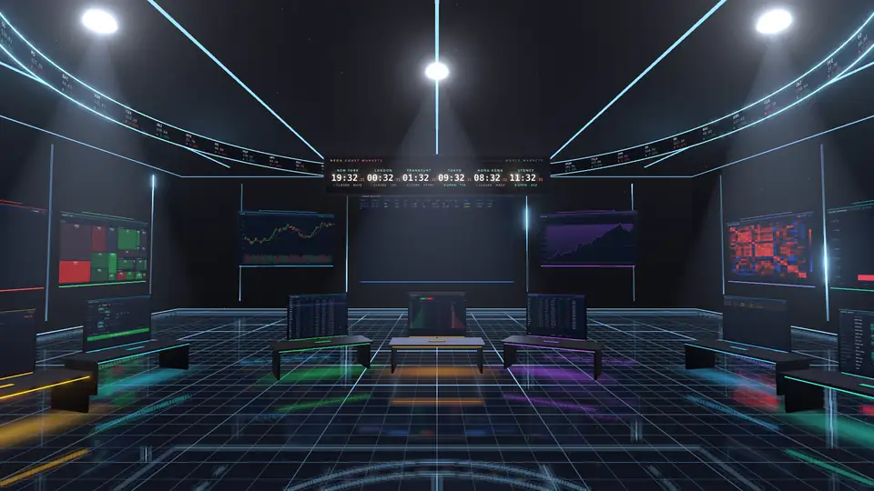
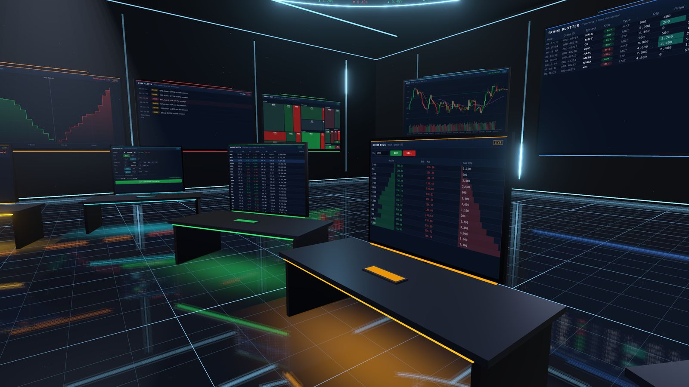
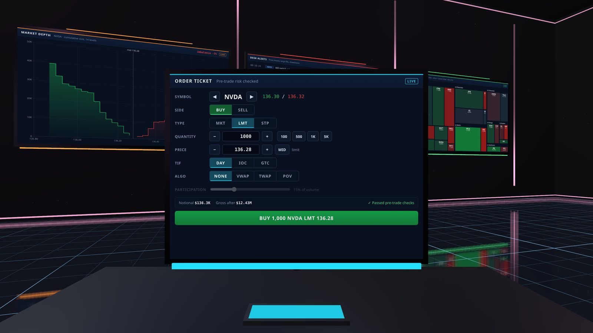
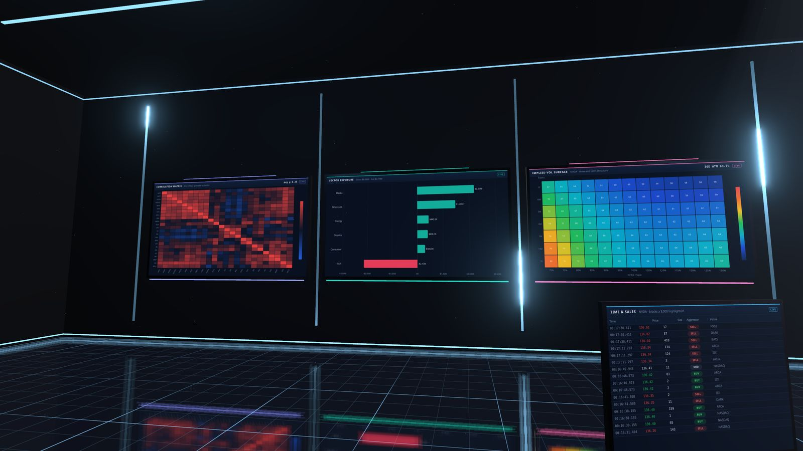
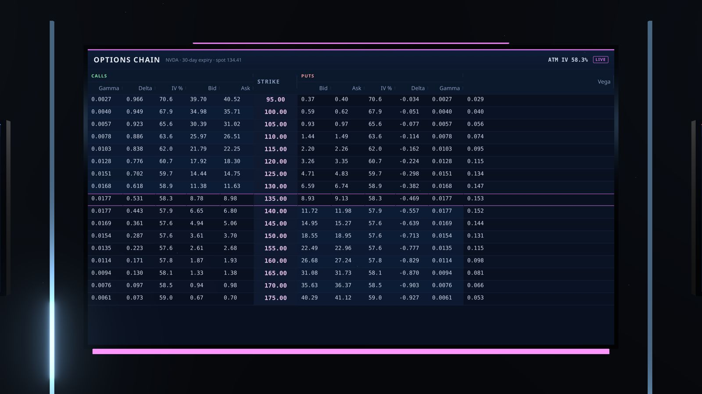
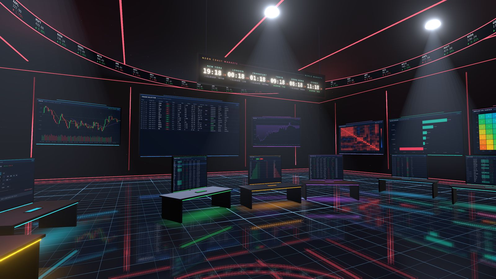
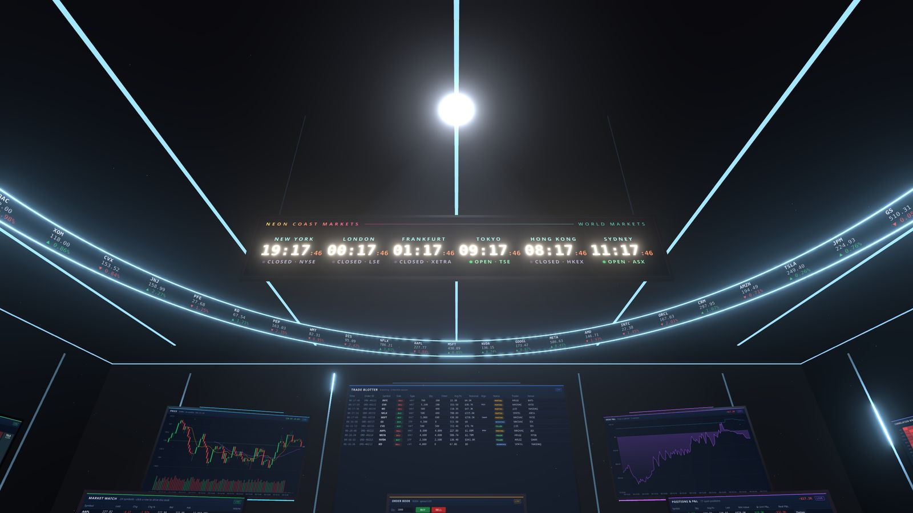

<h1 align="center">Trading Floor 3D</h1>

<p align="center">
  A walkable 3D trading floor whose screens are <b>live AG Grid tables, ECharts charts and HTML trading controls</b>,<br />
  drawn into WebGL with Chrome's HTML-in-Canvas API, and still fully clickable.
</p>

<p align="center">
  <a href="https://trading-floor-3d.vercel.app/"></a>
  <a href="https://developer.chrome.com/docs/web-platform/html-in-canvas"></a>
  
  
  
  
  
  <a href="LICENSE"></a>
</p>

<p align="center">
  <a href="https://trading-floor-3d.vercel.app/"></a>
</p>

<p align="center">
  <a href="https://trading-floor-3d.vercel.app/"><b>Open the demo</b></a> ·
  <a href="https://trading-floor-3d.vercel.app/how-it-was-built"><b>How it was built</b></a>
</p>

Walk around with WASD, click any screen, and use it: select rows, type into the order ticket, cancel orders, hit the kill switch. Every screen is real DOM, drawn into the 3D scene each time it repaints, and the browser maps your clicks back through each screen's perspective. All market data, orders and positions are simulated in the browser.

## Screens

<table>
  <tr>
    <td width="50%"><br /><b>Desks.</b> Market Watch, Order Book and Positions & P&L, all live AG Grid.</td>
    <td width="50%"><br /><b>Order ticket.</b> Market, limit and stop orders, time in force, VWAP/TWAP/POV, pre-trade risk checks.</td>
  </tr>
  <tr>
    <td><br /><b>Analytics wall.</b> Correlation matrix, sector exposure and an implied-volatility surface in ECharts.</td>
    <td><br /><b>Options chain.</b> Calls and puts with implied volatility and greeks, re-priced live.</td>
  </tr>
  <tr>
    <td><br /><b>Kill switch.</b> Halts the desk, cancels every working order and turns the room red.</td>
    <td><br /><b>World clocks.</b> Six exchanges with their live session status, above a scrolling ticker.</td>
  </tr>
</table>

## Run it

**Requires Chrome 157 or later on a desktop or laptop**, where HTML-in-Canvas shipped to stable. Other browsers and touch devices get a page with screenshots instead (see [Unsupported devices](#unsupported-devices)).

```bash
npm install
npm run dev              # open the printed URL in Chrome
npm run build            # static site in dist/: the demo and the how-it-was-built page
npm run smoke            # end-to-end test in real headless Chrome (CHROME_PATH=... to override)
npm run check:fallback   # checks the device gate on the production build
```

URL options:

| Option | Effect |
| --- | --- |
| `?dpr=1` | Lightest load: one texel per CSS pixel |
| `?dpr=2` | Full retina; the default cap is 1.5 |
| `?fx=low` | No floor reflections or bloom, for weaker GPUs |
| `?force=1` | Skip the device check and try anyway |

## Controls

| Input | Action |
| --- | --- |
| W A S D, Shift | Walk, run |
| Mouse | Look around |
| Click or E | Fly to the screen under the crosshair and free the cursor to use it |
| Q, or click empty space | Step back from a screen and keep walking |
| Esc | Free the cursor. Screens stay live and clickable from wherever you stand |

## What's in the room

| Where | Screens |
| --- | --- |
| North wall | **Trade Blotter** (AG Grid), **Price** (candlesticks, MA 10/30, volume), **Desk P&L** |
| East wall | **Correlation Matrix** (24×24 heatmap of rolling returns), **Sector Exposure**, **Implied Vol Surface** (strike × expiry heatmap) |
| West wall | **Market Map** (treemap; click a tile to select that symbol), **Desk Alerts**, **Market Depth** (cumulative bid/ask) |
| South wall | **Options Chain** (calls and puts with IV and greeks), **Risk Controls** (kill switch, limits, flatten all), **Order Flow** (Sankey: trader → venue → side) |
| Front desks | **Market Watch**, **Order Book** with a quick ticket, **Positions & P&L** with per-row flatten |
| Side pods | **Order Ticket**, **My Orders** (amend and cancel), **Time & Sales**, **Cross-Asset** (FX, rates, commodities, crypto, VIX) |
| Overhead | Ticker-tape ring, and a world-clock board for New York, London, Frankfurt, Tokyo, Hong Kong and Sydney with each exchange's session status |

Selecting a symbol anywhere (Market Watch, Positions, Market Map, or the ticket's ◀ ▶) moves the whole desk to it: chart, book, depth, tape, options chain and vol surface. The room's neon follows the desk, drifting green or magenta with P&L and pulsing red while the kill switch is engaged.

## How it works

- **Panels.** `index.html` has `<canvas content="drawable">`. Each panel is appended as a `drawable` child, so it keeps real layout, styles, events and accessibility. Charts use ECharts' SVG renderer, so they are ordinary DOM too.
- **Uploads.** `src/drawable.ts` listens for the canvas `paint` event, which lists the panels that changed. Each frame it uploads those with `gl.texElementSubImage2D` into textures wrapped in `THREE.ExternalTexture`. Uploads are capped by distance (12 / 6 / 3 Hz), uncapped for the screen in use, and deferred while a panel is out of view.
- **Hit testing.** Each frame, every panel's quad is projected to the screen as one perspective 4×4 matrix and passed to `canvas.updateElementGeometry`, which routes real input to the DOM at any angle. Panels with a corner behind the camera get their geometry cleared.
- **Focus mode.** The camera stands where one panel CSS pixel maps to one screen pixel, so text is crisp and drags move 1:1.
- **Lighting.** `src/post.ts` renders HDR, then bloom, then sRGB. Neon is HDR and blooms. Screens are drawn just below the bloom threshold, so text never blurs and colours match the DOM exactly.

The [how-it-was-built page](https://trading-floor-3d.vercel.app/how-it-was-built) has the diagram, the code, and the API behaviour verified in Chrome 158.

### Unsupported devices

`src/main.ts` checks for HTML-in-Canvas and for a mouse or trackpad before loading anything heavy. Phones, tablets, Safari, Firefox and Chrome before 157 get a small page with screenshots, a copy (or share) link for desktop, and a link to the write-up. The 3D app is the entry's only dynamic import, so those devices never download its 2.7 MB bundle.

## Project layout

```
src/
  main.ts            entry: device check, then the 3D app or the fallback page
  support.ts         HTML-in-Canvas and pointer detection (no dependencies)
  app.ts             the 3D app: wiring and render loop
  drawable.ts        HTML-in-Canvas ↔ Three.js bridge: uploads, hit-test geometry, screen shader
  world.ts           room, screens, desks, lighting, mood
  post.ts            bloom pipeline
  controls.ts        walking and focus mode
  feed.ts            simulated market, order engine, risk, options, correlations
  panels/            AG Grid tables, ECharts charts, trading controls, world clocks
  fallback.ts        page for unsupported devices
  site/, how/        shared styles for the non-3D pages
public/screens/      screenshots used by the fallback page and this README
scripts/             smoke test and fallback check (headless Chrome via Puppeteer)
```

## Limits

- Texture memory grows with the square of the pixel ratio: about 66 MB at 1, 150 MB at 1.5 and 265 MB at 2.
- Where screens overlap on screen, the stacking order is set once at startup (desk monitors above wall screens), because Chrome 158 never reorders drawables after their first geometry update. Hit testing also knows nothing about 3D occluders: a click on a desk that hides part of a wall screen goes to the screen.
- Drag gestures (column resize, sliders) are designed for focus mode, where the mapping is 1:1.
- Panels avoid native `<select>` pop-ups; the ticket uses segmented buttons instead.

## License

MIT, see [LICENSE](LICENSE). Built by [Andrea Dito](https://andreadito.com).
